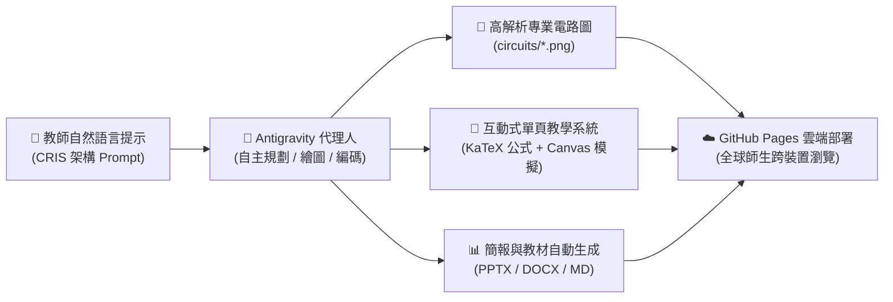

# 🎓 115學年度上學期教育部高優計畫教師實務增能研習
### ⚡ Google Antigravity 代理 AI 教學實戰 ✕ 技高電機電子群數位教材庫

  <b>「自然語言出題 ➔ 閉迴路標準電路圖繪製 ➔ 現代化互動網頁 ➔ GitHub Pages 一鍵雲端發布」</b> 
  專為技術型高中電機與電子群教師打造的 AI 代理人輔助備課與互動教學示範平台。

---

## 🌐 線上互動教學系統入口 (Live Web Modules)

| 單元編號 | 系統名稱 | 檔案入口 | 核心教學內容與功能特色 |
| :---: | :--- | :--- | :--- |
| **01** | **研習旗艦總入口網站** | [`index.html`](./index.html) | 整合 9 大研習核心實戰模組、標準電學／電子學題庫切換、Prompt 範本一鍵複製與微課影音展示。 |
| **02** | **雙機虛擬電子儀表互動系統** | [`instrument.html`](./instrument.html) | 模擬 **GDS-2102E 數位示波器 ＋ MFG-2110 信號產生器**，支援工業電子丙級術科試題二量測、CH1/CH2 雙通道與李沙育圖形。 |
| **03** | **電子學：BJT 小訊號 $r_\pi$ 模型專頁** | [`electronics_bjt.html`](./electronics_bjt.html) | 共射極 (CE) 實體偏壓電路與 $r_\pi$ 交流等效模型高清雙圖對照、雙向公式推導（基極電流法／互導法）與**即時增益動態模擬器**。 |
| **04** | **WebCam ✕ YOLO11 AI 視覺實戰** | [`yolo_webcam_course.html`](./yolo_webcam_course.html) | 涵蓋 OpenCV 1:1 防變形校正、四宮格雙鏡頭監控、YOLO11-Pose 17 關鍵點追蹤、手勢舉手拍照與長者跌倒全螢幕警報。 |
| **05** | **ESP32 ✕ MQTT 雲端智慧物聯網** | [`esp32_mqtt_course.html`](./esp32_mqtt_course.html) | 涵蓋 I2C 總線共用（BME280 + OLED）、四鍵多功能碼表、mqttgo.io 跨網遙控與硬體安全除錯金句。 |
| **06** | **GitHub Pages 發布教學 SOP** | [`github_tutorial.html`](./github_tutorial.html) | 圖解 Antigravity 代理人免指令自動化推送與 GitHub Pages 靜態網站發布全流程。 |
| **07** | **AI 成績正規化與學情儀表板** | [`grades.html`](./grades.html) | 展示手寫成績單自動正規化、加權平均計算、不及格預警標記與常態分佈視覺化圖表。 |

---

## 🏗️ 系統架構與工作流 (System Architecture)

---

## 📐 電學與電子學標準圖庫 (`circuits/`)

本專案所有電路圖與特性曲線皆經由高解析度向量級繪製與視覺防重疊校準：
- **`circuit1_series_parallel.png`**：基本電學 — 串並聯電阻網路化簡與分支電流計算。
- **`circuit2_thevenin.png`**：基本電學 — 戴維寧等效電路（$E_{th}, R_{th}$）與負載功率分析。
- **`circuit3_max_power.png`**：基本電學 — 最大功率轉移定理特性曲線（$R_L = R_{th} = 5\,\Omega, P_{L(\max)} = 20\,\mathrm{W}$）。
- **`circuit4_schematic_ce_amp.png`**：電子學 — BJT 共射極 (CE) 交流放大器實體分壓偏壓電路圖（含交連電容 $C_1, C_2$ 與旁路電容 $C_E$）。
- **`circuit4_r_pi_model.png`**：電子學 — BJT 交流小訊號 $r_\pi$ 混合等效模型（整數電壓增益 $A_v = -250$，180° 反相放大）。

---

## 📦 簡報與教學資源下載

- 📊 **第一場研習主簡報**：[`slides.pptx`](./slides.pptx)（16:9 寬螢幕大字動畫版）
- 📊 **YOLO AI 視覺專題簡報**：[`yolo_webcam_slides.pptx`](./yolo_webcam_slides.pptx) ｜ 📄 講義：[`yolo_webcam_handout.md`](./yolo_webcam_handout.md)
- 📊 **ESP32 物聯網專題簡報**：[`esp32_mqtt_slides.pptx`](./esp32_mqtt_slides.pptx) ｜ 📄 講義：[`esp32_mqtt_handout.md`](./esp32_mqtt_handout.md)
- 📝 **研習實施計畫書**：[`115學年度上學期高優計畫教師實務增能研習實施計畫書.docx`](./115學年度上學期高優計畫教師實務增能研習實施計畫書.docx)

---

## 🛡️ 品質與環境規範

- **數學公式渲染**：全站整合 **KaTeX v0.16.8**，支援行內 `$...$` 與區塊 `$$...$$` LaTeX 語法即時渲染。
- **響應式設計 (RWD)**：支援桌面寬螢幕教學投影、平板與智慧型手機跨裝置操作。
- **零後端依賴**：純 HTML5 / CSS3 / Vanilla JS 架構，可離線單檔執行或部署於任何靜態託管服務。
